<p align="center">
  
</p>

<p align="center">
  <a href="https://github.com/klepto/utrecorder/tags"></a>
  <a href="https://github.com/klepto/utrecorder/pkgs/container/utrecorder-server"></a>
  
  
  <a href="LICENSE"></a>
  <br>
  <sub>
    <a href="https://recorder.utbt.net"><b>Live Preview</b></a>
    &nbsp;&middot;&nbsp;
    <a href="https://archive.org/details/utbt99"><b>Internet Archive</b></a>
    &nbsp;&middot;&nbsp;
    <a href="https://discord.gg/utbt"><b>Discord</b></a>
  </sub>
  <br><br>
  Toolkit for recording Unreal Tournament 99 demos.
</p>

<p align="center">
Automatically resolves and downloads dependencies and turns a
demo file into a video recording with frame perfect output on <b>any hardware</b>.
</p>

## How it works

<p align="center">
  
</p>

## Features
- **Zero setup:** <small>Downloads ut99, installs the OldUnreal 469 patch and reuses the 
  installation for every recording.</small>
- **Dependency resolution:** <small>Finds every map, mod and texture package a demo needs, at the exact version it was recorded with, and fetches missing ones from redirect servers.</small>
- **Frame-perfect capture:** <small>Drives the game clock frame by frame, so the output does not depend on how fast the machine renders.</small>
- **Any hardware:** <small>Renders in software on a virtual screen, with no GPU or display needed.</small>
- **Smooth motion:** <small>Renders more frames than the video keeps and blends them.</small>
- **In-sync audio:** <small>Records the sound in a second playback whose clock steps with the sound mixer.</small>
- **Trimmed output:** <small>Starts at the spawn, ends right after the timer stops.</small>
- **AV1 video:** <small>Uses best compression presets and muxes picture and sound into one mp4.</small>
- **Configurable output:** <small>Records at any resolution and frame rate, with any ffmpeg video encoder.</small>
- **Discord-ready:** <small>Sizes each video to fit the Discord embed limit, so shared links play in the chat.</small>
- **Recording server:** <small>Watches the utbt.net cap list, queues new caps and records them on its own.</small>
- **Internet Archive backups:** <small>Keeps fresh videos on the server, then moves them to the Archive.</small>
- **Web interface:** <small>Browse recordings, follow the queue and see statistics.</small>
- **CLI:** <small>Records a single demo from its URL, with no server needed.</small>

## Quick start

### Record a single demo

Needs JDK 25 and a 32-bit C toolchain on Windows or Linux: MinGW (`i686-w64-mingw32-gcc`) or Visual Studio on
Windows, `gcc` with `gcc-multilib` on Linux. On Linux, the game also needs the 32-bit runtime and an X display, as set
up in [`docker/Dockerfile`](docker/Dockerfile). Build the CLI from a clone of the repository and record a demo from its URL:

```sh
./gradlew :utrecorder-cli:run --args="<demo-url>"
```

The first run downloads and installs Unreal Tournament 99. The CLI prints the path of the mp4 on standard out and its log on
standard error.

### Run the server

The server image is published to GHCR, one tag per version, with no `latest` tag.

```sh
docker run -d --init --name utrecorder -p 8080:8080 \
  -v utrecorder-home:/var/lib/utrecorder \
  -v utrecorder-cache:/var/cache/utrecorder \
  ghcr.io/klepto/utrecorder-server:0.1.3
```

The web interface is at http://localhost:8080. The first recording takes longer, because the server downloads and
installs Unreal Tournament 99 first. Both volumes keep it for later runs.

Every setting is an environment variable named after its key, with a `UTRECORDER_` prefix. For example, the server
uploads to the Internet Archive only when both of these are set:

```sh
-e UTRECORDER_SERVER_ARCHIVE_ACCESS_KEY=<access-key>
-e UTRECORDER_SERVER_ARCHIVE_SECRET_KEY=<secret-key>
```

## Modules

### [utrecorder-core](utrecorder-core)

The recording pipeline. It turns a demo into an mp4 and a thumbnail in five stages: fetching the demo, preparing the
installation, resolving packages, capturing and muxing.

- **Demo playback:** stages a demo in the installation with the hooks and the UnrealScript package, and reads the marks
  the game logs at the start and the end of the run.
- **Video capture:** plays the demo without sound and streams every rendered frame to ffmpeg over the loopback. The
  resolution and bitrate come from a ladder of tiers, picked so the video fits its size budget.
- **Audio capture:** plays the demo a second time with sound, writes a wav through the OpenAL wave output and places
  it against the video by the marks.
- **Muxing:** joins picture and sound into one mp4 with ffmpeg and takes a thumbnail from it.
- **Watchdogs:** kills a capture that stops making progress, so a stuck game never blocks a recording.

### [utrecorder-ut99](utrecorder-ut99)

Everything about the game itself, independent of recording.

- **Installer:** downloads the Unreal Tournament 99 GOTY ISO, extracts it and installs the OldUnreal 469 patch, on
  Windows and Linux.
- **Demo reader:** reads a demo file and lists the packages it needs, with the GUID of each.
- **Package resolution:** finds each package in the installation or the packages directory, else downloads it from the
  redirect servers at the GUID the demo recorded. Downloaded packages expire after a while.
- **Game tools:** runs the game and UCC, edits game ini files and compiles UnrealScript.
- **Command line:** `install` provisions an installation, and `make` compiles an UnrealScript package with UCC against
  it. The build uses it to compile [utrecorder-uscript](utrecorder-uscript).

### [utrecorder-hooks](utrecorder-hooks)

Native C code loaded into the game process.

- **uthooks:** hooks the presented frame (`SwapBuffers` on Windows, `SDL_GL_SwapWindow` on Linux) and steps the engine
  clock by a fixed amount per frame, so the output does not depend on how fast the machine renders. In video mode, it
  reads each frame back and sends it to the recorder. In audio mode, it steps the clock one mixer period per frame
  instead, so the sound stays in line with the picture.
- **utinject:** starts the game suspended, loads the hook library into it, then resumes it.

### [utrecorder-uscript](utrecorder-uscript)

UnrealScript package loaded into the game.

- **Console:** drives unattended playback, logs the start and end marks of the run and quits once the demo ends.
- **HUD:** hides chat and other text messages.
- **Smoothing:** smooths the movement and view of the player who recorded the demo. Ported from DemoSmoothing by
  Berserker_BG, with his permission.
- **NPLoader guard:** stops the NPLoader client checks that a demo replays from running.

### [utrecorder-server](utrecorder-server)

The recording service behind the live website.

- **Cap list:** reads the newest verified caps from utbt.net every minute, and the whole list again from time to time.
- **Queue:** keeps the fastest run of each player on each map, and puts recent caps, higher medals and shorter runs
  first.
- **Recording:** records each queued cap with the core, retries failures, and holds back demos that miss a package.
- **Uploads:** uploads each video of an older cap to the Internet Archive right after recording, and each video of a
  recent cap a couple of days after.
- **Cache:** keeps watched videos on the server and removes unwatched ones, within the free disk space. Removes an
  archived video of an older cap that nobody watched right away.
- **HTTP API:** serves the recordings, the queue, the jobs, the statistics and the videos, with link previews for
  Discord.

### [utrecorder-web](utrecorder-web)

The web interface of the server, built with React and Mantine. It lists recordings, shows the queue and the jobs in
progress, plays the videos and shows statistics.

### [utrecorder-cli](utrecorder-cli)

Command-line recorder. It records a single demo from its URL with the core, logs progress on standard error and prints
the path of the mp4 on standard out.

### [utrecorder-common](utrecorder-common)

Shared utilities of every Kotlin module: configuration from system properties and environment variables, directories,
downloads, archives, embedded artifacts, logging and progress reporting.

## Acknowledgements

- [OldUnreal](https://www.oldunreal.com) for the [469 patch](https://github.com/OldUnreal/UnrealTournamentPatches),
  which keeps Unreal Tournament 99 running on modern systems.
- Berserker_BG for DemoSmoothing, which the demo smoothing in [utrecorder-uscript](utrecorder-uscript) is ported from.
- [UT Files](https://ut-files.com) for the package redirect.
- [utbt.net](https://utbt.net) for the cap list, the demos and the package redirect.
- The [Internet Archive](https://archive.org) for hosting the game ISO and the recorded videos.


## Disclaimer

utrecorder is a fan project. It is not affiliated with or endorsed by Epic Games. Unreal and Unreal Tournament are
trademarks or registered trademarks of Epic Games, Inc.

The repository does not include the game. The installer downloads Unreal Tournament 99 and the OldUnreal 469 patch
from public sources the first time it runs. Maps, mods and demos belong to their authors.

## License

utrecorder is released under the [MIT License](LICENSE). You may use, modify, redistribute and sell it, as long as
the copyright notice and the license text stay with every copy.
